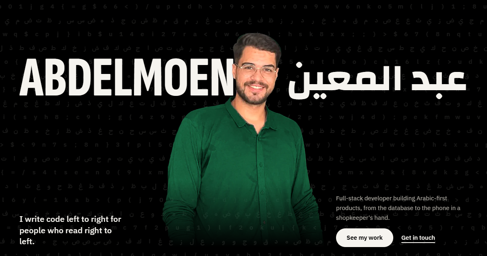

# Abdelmoen Al-Barbari | Portfolio V2

A one-page portfolio for a full-stack developer building Arabic-first products. Built with plain **HTML, CSS and JavaScript**, with no framework and no build step.

**Live:** [abdelmoen1.github.io/abdelmoen-frontend-portfolio](https://abdelmoen1.github.io/abdelmoen-frontend-portfolio/)



---

## Projects

### Hisbah (حسبة)

A debt book and sales app for small grocery shops. Staff sell from an Android phone, each customer's debt stays under their name, and the owner runs stock and reports from any browser.

- [Open Hisbah](https://hisbah-web.vercel.app) | [View the code](https://github.com/abdelmoen1/micro-erp-system)
- Laravel 12, React 19, Flutter, MySQL

### GoTrainee

A platform that lets small organizations order digital solutions without hiring anyone. An AI chat turns the need into a clear brief, and a tested freelance team delivers it one milestone at a time.

- [Open GoTrainee](https://gotrainee-web.onrender.com) | [View the code](https://github.com/abdelmoen1/Frontend)
- Laravel 12, React 19, Gemini, PostgreSQL

---

## Features

- English and Arabic, with a full right-to-left layout switch
- Each project section keeps its product's real colors and type
- A working Hisbah sale demo, including the customer debt limit
- A scroll-driven walkthrough of the GoTrainee project workflow
- Hero background drawn on canvas: Latin and Arabic letters running in opposite directions
- Responsive down to phone width, keyboard accessible, and respects reduced motion settings

---

## Run it locally

Open `index.html` in a browser, or serve the folder with any static server:

```bash
npx live-server --port=5500
```

---

## Contact

- Email: [aboodbarbari543@gmail.com](mailto:aboodbarbari543@gmail.com)
- LinkedIn: [Abdelmoen Al-Barbari](https://www.linkedin.com/in/abdelmoen-al-barbari-8055b43b2)
- Bright Gaza: [Talent profile](https://brightgaza.com/talents/4601)
- GitHub: [abdelmoen1](https://github.com/abdelmoen1)
- Instagram: [@abdelmoen1](https://instagram.com/abdelmoen1)

---

*© 2026 Abdelmoen Al-Barbari*
